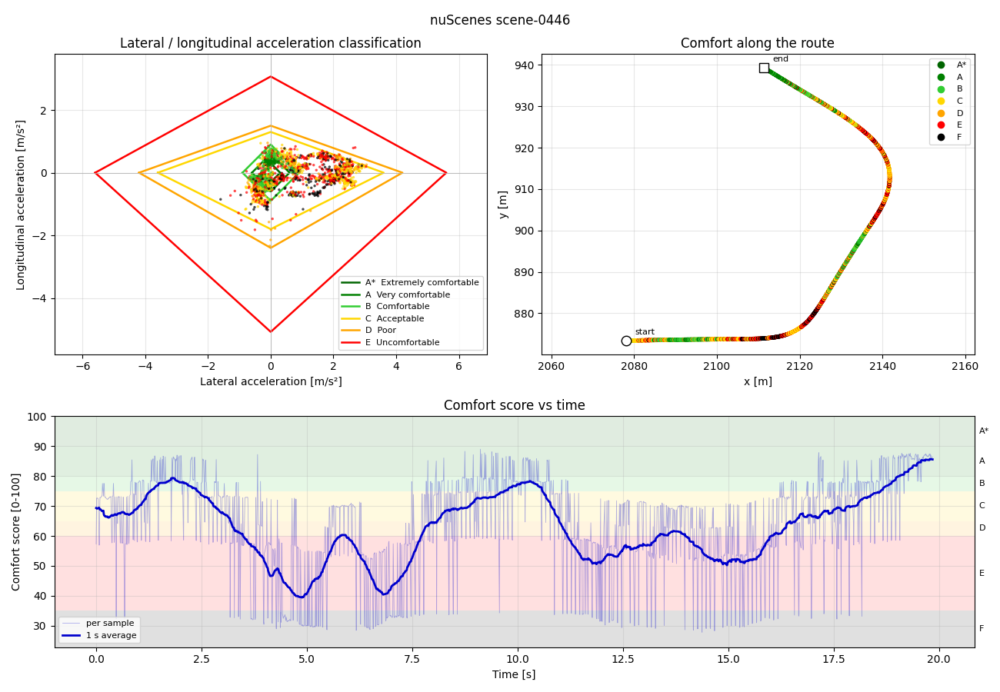

# avcomfort: occupant comfort assessment for autonomous vehicles

[](https://github.com/echod-wmg/av-comfort-assessment/actions/workflows/tests.yml)

`avcomfort` rates ride comfort from vehicle IMU data. It classifies every
sample by **acceleration and jerk** into seven comfort levels (A* to F, after
the VeriCAV occupant-comfort scale), computes a **0–100 comfort score**, and
summarises a whole drive. It reads:

* **nuScenes** autonomous-vehicle drives (CAN bus expansion: 100 Hz IMU and pose),
* drives logged by a **Raspberry Pi + BerryGPS-IMU** data acquisition unit
  (DAU), including real-time assessment on the vehicle,
* any **CSV** with `time_s, acc_lat, acc_long`.

The tool comes from my MSc dissertation at the University of Bath (2022).
The full dissertation is in [`docs/report/`](docs/report/2022_MSc_dissertation_av_comfort.pdf).



*nuScenes scene-0446, an S-bend. The route is coloured by comfort level: the
straights are comfortable (green) and both bends drop to uncomfortable (red
and black). Each dot's colour is its final level, which includes jerk, so some
gentle-acceleration samples still rate poorly.*

## Install

```bash
git clone https://github.com/echod-wmg/av-comfort-assessment.git
cd av-comfort-assessment
python -m venv .venv && source .venv/bin/activate
pip install -e ".[dev]"          # add ,maps for web-map backgrounds (contextily)
```

## Usage

```bash
# nuScenes: point at the extracted CAN bus expansion folder
avcomfort nuscenes --can-bus ~/data/nuscenes/can_bus --scene 103 --out results

# a drive logged by the BerryGPS-IMU DAU (2022 file layout: Scene02-Lateral.txt, ...)
avcomfort berry --dir ~/drives/bath --scene Scene02

# any CSV (time_s, acc_lat, acc_long [, lon, lat | x_m, y_m, speed_mps])
avcomfort csv tests/data/bath_scene02.csv

# options
avcomfort csv drive.csv --jerk-window 0.5     # jerk smoothing window [s]
avcomfort model > my_model.json               # dump thresholds, edit, then --model my_model.json
```

Each run writes `<scene>_comfort.csv` (per-sample levels and scores),
`<scene>_summary.json` and `<scene>_report.png`.

```python
from avcomfort import load_nuscenes, assess, summarise

drive = load_nuscenes("~/data/nuscenes/can_bus", 103)
result = assess(drive)              # adds jerk, level, rating, score per sample
summarise(result)                   # {'mean_score': 68.49, 'overall_rating': 'C', 'time_share_pct': {...}, ...}
```

## How it works

1. **Load.** Each source becomes one table of time, lateral and longitudinal
   acceleration, plus position and speed where available. For nuScenes, IMU
   `x` is longitudinal and `y` is lateral, and the 50 Hz pose is interpolated
   onto the 100 Hz IMU timestamps.
2. **Jerk.** Acceleration is smoothed with a 1 s moving average, then
   differentiated. Smoothing stops sensor noise from dominating the jerk.
   Change the window with `--jerk-window`.
3. **Classify.** Each sample gets a comfort level from its acceleration and
   jerk (see below).
4. **Score.** Each sample gets a 0–100 score. The drive's rating comes from
   its time-weighted mean score.
5. **Report.** A per-sample CSV, a JSON summary and a report figure: the
   acceleration plot on the comfort regions, the route coloured by comfort
   level (or acceleration over time when there is no position), and the
   score over time.

## Comfort model

Each level is a rhombus ("kite") in the lateral/longitudinal plane, so
lateral, accelerating and braking motion get different limits. A sample takes
the first level whose acceleration kite **and** jerk kite both contain it. In
practice that is the worse of the two.

| Level | Rating | Lateral [m/s²] | Accel [m/s²] | Braking [m/s²] | Jerk [m/s³] | Score base |
|---|---|---|---|---|---|---|
| Extremely comfortable | A* | < 0.3 | < 0.3 | < 0.3 | < 0.2 | 100 |
| Very comfortable | A | < 0.6 | < 0.6 | < 0.6 | < 0.4 | 90 |
| Comfortable | B | < 0.9 | < 0.9 | < 0.9 | < 0.6 | 80 |
| Acceptable | C | < 3.6 | < 1.3 | < 1.8 | < 0.8 | 75 |
| Poor | D | < 4.2 | < 1.5 | < 2.4 | < 0.95 | 65 |
| Uncomfortable | E | < 5.6 | < 3.07 | < 5.08 | < 2.0 | 60 |
| Extremely uncomfortable | F | beyond | | | | 35 |

The thresholds come from Bae et al. (2019), Karjanto et al. (2017) and VeriCAV
(Connected Places Catapult, 2021). Within a level the score falls with the
total acceleration:
`score = base − points · (|a_lat| + |a_long|) / divisor`.
The level-specific `points` and `divisor` (with a separate braking divisor)
are in `avcomfort/model.py`. The drive's overall rating comes from its
time-weighted mean score: >90 A*, >80 A, >75 B, >65 C, >60 D, >35 E, else F.
Run `avcomfort model` to see the full parameter set.

## On-vehicle data acquisition unit


The DAU was a Raspberry Pi 4B with an OzzMaker BerryGPS-IMU v4 (LSM6DSL
accelerometer, u-blox CAM-M8 GPS, 10 Hz), an external GPS antenna, a USB
camera and a 3-D printed case. I used it on a Honda Civic around Bath (UK).
[`daq/berry_logger.py`](daq/berry_logger.py) is the cleaned-up logger. It
assesses comfort live, reads GPS in a background thread, and writes one CSV
per drive that `avcomfort csv` can re-assess. Run it with `--simulate` to try
it without hardware. The setup steps are in the file header.

## Data

* **nuScenes** is not redistributed here (CC BY-NC-SA 4.0). Download the
  *CAN bus expansion* from <https://www.nuscenes.org/download> and pass its
  folder to `--can-bus`. Scenes 0061, 0103 and 0916 were used in the
  dissertation. The figures above are derived from nuScenes data,
  © Motional, used under CC BY-NC-SA 4.0.
* `tests/data/bath_scene02.csv` is a 50 s extract of my own test drive
  (acceleration and speed only; GPS removed).

## Limitations

* Only horizontal acceleration and jerk are scored. Vertical vibration
  (ISO 2631), motion sickness, noise and thermal comfort are not.
* The score formula and thresholds are heuristic, synthesised from the
  literature. They have not been calibrated against occupant ratings.
* The IMU must be aligned with the vehicle axes. The logger has axis and sign
  flags for the mounting, but no automatic alignment.

## Dissertation

*Design of the model for the real-time occupant's comfort assessment within
the autonomous vehicle*, MSc dissertation, University of Bath, 2022:
[PDF](docs/report/2022_MSc_dissertation_av_comfort.pdf). It covers the
literature review, the DAU design, the comfort model and the results. Some literature figures are reproduced from the cited sources.

## License

Code: [MIT](LICENSE). nuScenes-derived figures: CC BY-NC-SA 4.0 (see Data).
